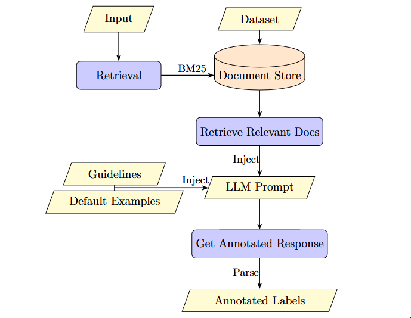

# rag-ner-pipeline

Named Entity Recognition on Italian corpora with an LLM, a retrieval step and an
annotation-guidelines prompt, with no prior fine-tuning of the model.

This is the code for my master's thesis, **Approaches based on RAG and Prompt
Engineering for Named Entity Recognition on Legal Documents** (Università degli
Studi di Palermo, LM-18, Data, Algorithms and Machine Intelligence, 2025/26).
The full text is in [`docs/thesis.pdf`](docs/thesis.pdf).

## The idea

Supervised NER models such as BERT need a lot of annotated data, which is often
not available in niche domains like legal documents. LLMs can do NER without
fine-tuning, but they tend to produce unreliable outputs when asked for a list
of labels. This project makes an LLM annotate text in place with examples
that are retrieved from a pre-annotated corpus according to the input
sentence:

- **A text-based annotation format** that is natural for LLM generation and
  trivial to parse (see below), instead of BIO tags.
- **BM25 retrieval** of the `top_k` most similar annotated sentences, injected
  as few-shot examples. BM25 favors sentences that share rare words, so the
  retrieved sentences often contain the same entities as the input. In the
  experiments it clearly outperformed sentence-embedding similarity.
- **A long guidelines prompt** that defines what an
  entity is, with examples for each rule, plus a set of default input/output
  examples.
- **Llama 3.1** (8B and 70B, 4-bit quantized, temperature 0) served with
  Ollama.

## Pipeline Architecture


### Annotation format

Entities are marked in the sentence itself, so the model returns the input text
with delimiters around the entities:

| Entity type | Tag | Delimiters | Example |
|---|---|---|---|
| Person | PER | `((…))` | `((Pier))` |
| Location | LOC | `[[…]]` | `[[Perugia]]` |
| Organization | ORG | `{{…}}` | `{{Eni}}` |
| Miscellaneous | MISC | `<<…>>` | `<<25-12-2025>>` |

Parsing is a regular expression per-tag (`\(\((.*?)\)\)`, `\[\[(.*?)\]\]`,
`\{\{(.*?)\}\}`, `\<\<(.*?)\>\>`, see `process_raw_dataset` in
[`src/util.py`](src/util.py)). The datasets are converted from BIO to this
parallel format, where each sample has the plain `text` and the annotated
`pred` text, so that the model can see both input and output in the examples.

## Results

All results are from [the thesis](docs/thesis.pdf): 10-fold cross-validation,
with the training folds as the retrieval corpus and the test fold annotated by
the full pipeline. Values are F1; `top_k = 0` means no retrieved examples.

### Juridical sentences

| System | Precision | Recall | F1 |
|---|---|---|---|
| `bert-base-italian-xxl-cased` (fine-tuned baseline) | 0.915 | 0.920 | **0.917** |
| `hseBert-it-cased` (baseline) | 0.898 | 0.919 | 0.908 |
| `roberta-base` (baseline) | 0.874 | 0.897 | 0.885 |
| `distilbert-base-uncased` (baseline) | 0.788 | 0.824 | 0.805 |
| Llama 3.1 70B, `top_k = 5` | 0.873 | 0.876 | 0.875 |
| Llama 3.1 8B, `top_k = 7` | 0.860 | 0.819 | 0.836 |
| Llama 3.1 70B, `top_k = 0` | 0.821 | 0.844 | 0.832 |
| Llama 3.1 8B, `top_k = 0` | 0.776 | 0.756 | 0.765 |

With retrieval, the 70B model surpasses `roberta-base` and `distilbert` and gets
within about 4 F1 points of the best fine-tuned BERT, **without any training**.
Per-label results for the best config (Llama 3.1 70B, `top_k = 5`): PER 0.943, LOC 0.842, ORG 0.820.

### KIND (Llama 3.1 8B, `top_k = 7`)

| Dataset | F1 without retrieval | F1 with retrieval | Baseline F1 (BERT) |
|---|---|---|---|
| Italian Literature | 0.737 | **0.895** | 0.815 |
| Aldo Moro's works | 0.735 | 0.907 | **0.957** |
| WikiNews | 0.652 | 0.807 | **0.890** |
| De Gasperi's writings | 0.583 | 0.753 | **0.835** |

### Main findings

- F1 grows with `top_k` on every dataset, with diminishing returns, meaning the most
  useful examples are the first ones retrieved. The only exception is the 70B
  model on the juridical dataset, which peaks at `top_k = 5`.
- Retrieval is what makes the approach work: it adds between 4 and 17 F1 points
  over the same prompt without examples.
- Model size matters: 70B beats 8B by about 4 F1 points on the juridical
  dataset and is much more stable across folds.
- PER entities are the easiest to recognize. LOC and ORG are harder, and are
  the labels that improve most with the larger model.
- The approach needs no fine-tuning, and it can be adapted to any domain by changing the
  prompt or the retrieval corpus.

## Datasets

- **[KIND](https://github.com/dhfbk/KIND)**, from the Digital Humanities Unit of
  Fondazione Bruno Kessler: four Italian NER datasets (WikiNews, Italian
  Literature, Aldo Moro's works, De Gasperi's writings) with PER, LOC and ORG
  labels. Check its license before using it.
- **Juridical sentences**: 379,539 sentences from Italian legal documents,
  1,028 of them annotated with PER, ORG, LOC and MISC. **This dataset is not
  included and cannot be redistributed.**

Datasets are expected in `data/` as JSONL files in the format
below. `label` contains the character spans of each token with BIO tags:

```json
{
  "id": "1",
  "text": "Mario Rossi lives in Milan",
  "label": [[0, 5, "B-PER"], [6, 11, "I-PER"], [12, 17, "O"], [18, 20, "O"], [21, 26, "B-LOC"]]
}
```

## Setup

Requires Python 3.12 and [uv](https://docs.astral.sh/uv/).

```bash
git clone https://github.com/Impasse52/rag-ner-pipeline
cd rag-ner-pipeline
uv sync
```

To download Llama from Hugging Face, accept the model's license on the Hub and
put your access token in a `.env` file. For the retrieval pipeline, install [Ollama](https://ollama.com/) and pull the
models:

The experiments in the thesis ran on a workstation with an Intel i7-12700F,
48 GB of RAM and an NVIDIA RTX 6000 GPU. The context window was 64,000 tokens
for the 8B model and 10,000 for the 70B one.

### Evaluation

Entity-level evaluation: precision, recall and F1 over the sets of
`(entity text, label)` pairs, after stripping and title-casing the strings
(`evaluate_ner` in `src/util.py`). Results are written to
`experiments_results.json`.

## Limitations
- Only tested on Italian text, with a prompt written in Italian.
- Only Llama 3.1 8B and 70B were evaluated in the final experiments (Gemma 3
  and DeepSeek-R1 were tried earlier and performed worse). No fine-tuned LLM
  was tested.
- The number of retrieved examples is limited by the GPU memory available, as
  the context window directly affects memory use.
- The juridical dataset is small (1,028 annotated sentences) and strongly
  dominated by PER entities.